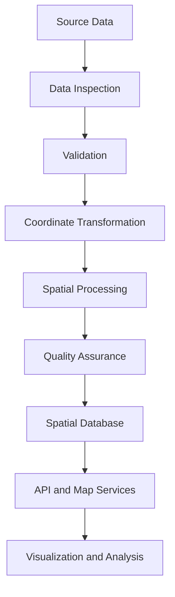

<div align="center">


<br>

<a href="https://github.com/Mhmd-dev777">
  
</a>
<a href="https://www.openstreetmap.org/">
  
</a>


<br><br>

### Turning coordinates into context.

**Maps are not just representations of places. They are interfaces for understanding the world.**

[Explore Projects](#-selected-projects) ·
[Technical Stack](#-technical-stack) ·
[Engineering Principles](#-engineering-principles)

</div>

---

## 01 / Profile

```text
NAME          Mohammed Al-Sultan
USERNAME      Mhmd-dev777
LOCATION      Riyadh, Saudi Arabia
SPECIALTY     Geospatial Engineering
DISCIPLINES   GIS · Spatial Databases · Web Mapping
INTERESTS     Open Data · Cartography · Spatial Analytics
```

I build software that helps people understand places, patterns, and relationships through geographic data.

My interests lie at the intersection of geospatial engineering, backend development, cartographic design, and open-source mapping.

I enjoy working across the complete spatial data lifecycle:

- Acquiring and validating geographic datasets.
- Transforming raw coordinates into useful spatial information.
- Designing efficient spatial database schemas.
- Building interactive maps and location-aware applications.
- Automating geospatial processing pipelines.
- Making geographic information accessible through reliable APIs.

My approach is simple: **accurate data, deliberate engineering, and maps that communicate clearly.**

---

## 02 / The Geospatial Stack

<div align="center">

| Layer | Technologies |
|:--|:--|
| Spatial Data | GeoJSON · GeoPackage · GeoParquet · Shapefile |
| Spatial Databases | PostgreSQL · PostGIS |
| Geospatial Processing | GDAL · GEOS · Shapely · GeoPandas |
| Web Mapping | MapLibre GL JS · Leaflet |
| Map Services | OGC API Features · WMS · WMTS |
| Backend Engineering | Python · FastAPI · SQLAlchemy |
| Data Engineering | Pandas · NumPy · DuckDB |
| Infrastructure | Linux · Docker · GitHub Actions |

</div>

### Languages

<p>
  
</p>

### Spatial & Backend Engineering

<p>
  
</p>

### Geospatial Ecosystem

| Tool | Primary Use |
|:--|:--|
| **PostGIS** | Spatial queries, geometry operations, spatial indexing |
| **GDAL / OGR** | Raster and vector data conversion |
| **GeoPandas** | Tabular spatial analysis |
| **Shapely** | Geometry manipulation and spatial predicates |
| **GeoPandas + DuckDB** | Analytical workflows over large spatial datasets |
| **MapLibre GL JS** | Interactive vector maps |
| **Leaflet** | Lightweight interactive web maps |
| **FastAPI** | Typed APIs for spatial services |

---

## 03 / Selected Projects

The following projects represent a proposed portfolio for this fictional developer. They are concepts until implemented and published in their respective repositories.

### `01 — AtlasGrid`

**A spatial data platform for organizing, validating, and serving geographic datasets.**

AtlasGrid is designed around the idea that geographic data should be easy to inspect, validate, query, and reuse.

**Core capabilities**

- Import common vector data formats.
- Validate geometry and coordinate reference systems.
- Normalize attributes and metadata.
- Execute spatial queries through a REST API.
- Generate dataset summaries and quality reports.
- Track dataset versions and processing history.

**Architecture**

```text
Geospatial Sources
       |
       v
Import & Validation
       |
       v
Normalization Pipeline
       |
       v
PostgreSQL + PostGIS
       |
       v
FastAPI Services
       |
       v
Applications & Clients
```

**Technology:** Python · FastAPI · PostGIS · SQLAlchemy · Docker

**Repository:** `atlasgrid`

---

### `02 — Riyadh Mobility Atlas`

**A location-based analytical platform for exploring urban mobility patterns.**

The project explores how spatial analysis can help explain accessibility, connectivity, and the geographic distribution of urban services.

**Planned capabilities**

- Visualize public geographic datasets.
- Analyze proximity to selected points of interest.
- Calculate network-based accessibility when suitable road-network data is available.
- Compare geographic indicators across administrative areas.
- Export analysis results in reusable formats.
- Display dataset provenance and limitations.

**Technical focus**

- Coordinate reference system management.
- Spatial joins and aggregation.
- Network analysis.
- Interactive thematic cartography.
- Reproducible analytical workflows.

**Technology:** Python · GeoPandas · PostGIS · MapLibre GL JS

**Repository:** `riyadh-mobility-atlas`

---

### `03 — GeoLint`

**A command-line validator for geographic datasets.**

GeoLint aims to make common geospatial data-quality checks repeatable and accessible to developers.

**Example workflow**

```bash
geolint inspect ./data/roads.geojson
geolint validate ./data/roads.geojson
geolint report ./data/roads.geojson --format json
```

**Planned checks**

- Invalid or empty geometries.
- Missing coordinate values.
- Unexpected geometry types.
- Duplicate feature identifiers.
- Missing required attributes.
- Coordinate reference system inconsistencies.
- Suspicious geographic extents.

**Design goals**

- Deterministic validation results.
- Machine-readable reports.
- Clear error messages.
- Configurable validation rules.
- Integration with continuous integration pipelines.

**Technology:** Python · Shapely · GDAL · Pytest · Click

**Repository:** `geolint`

---

### `04 — TileForge`

**A reproducible toolkit for preparing geographic data for web mapping.**

TileForge explores a repeatable pipeline from source datasets to optimized map-ready assets.

**Planned capabilities**

- Inspect vector and raster datasets.
- Normalize source metadata.
- Prepare vector data for tiling.
- Validate tile-generation outputs.
- Record processing parameters.
- Produce reproducible build reports.

**Engineering priorities**

- Streaming where supported.
- Memory-aware processing.
- Explicit coordinate transformations.
- Configurable zoom ranges.
- Reproducible builds.

**Technology:** Python · GDAL · Tippecanoe · Docker

**Repository:** `tileforge`

---

## 04 / Spatial Engineering Workflow

I approach geospatial problems as data engineering problems with an additional dimension: location.



### Quality Gates

| Stage | Validation |
|:--|:--|
| Ingestion | File integrity, supported formats, metadata availability |
| Geometry | Validity, emptiness, geometry-type consistency |
| Coordinates | CRS identification, plausible extents, transformation checks |
| Attributes | Schema consistency, null handling, identifier uniqueness |
| Processing | Reproducibility, feature counts, expected output types |
| Storage | Constraints, spatial indexes, query performance |
| Delivery | API schemas, response validity, map rendering |

A successful pipeline is not simply one that produces a map. It must also preserve data integrity, document transformations, and make its assumptions inspectable.

---

## 05 / Engineering Principles

### Accuracy before aesthetics

A beautiful map built on incorrect coordinates is still incorrect.

### Explicit coordinate systems

Coordinate reference systems should be identified, documented, and transformed deliberately. Coordinates must never be reprojected based on guesswork.

### Data provenance matters

Every dataset should have a traceable origin, documented processing history, and understandable limitations.

### Performance is part of usability

Spatial indexes, appropriate geometry representations, efficient queries, and carefully designed APIs improve the experience for both users and downstream systems.

### Reproducibility by default

Processing parameters, dependency versions, validation rules, and output formats should be documented whenever they affect results.

### Open standards over unnecessary lock-in

Prefer interoperable formats and well-documented interfaces when they meet the project's requirements.

---

## 06 / Spatial Data Standards

My geospatial interests include standards and formats that support interoperable geographic systems.

| Standard / Format | Purpose |
|:--|:--|
| GeoJSON | Geographic features represented as JSON |
| GeoPackage | Portable SQLite-based container for geospatial data |
| GeoParquet | Columnar storage for spatial datasets |
| WGS 84 | Common geographic coordinate reference system |
| EPSG identifiers | Referencing defined coordinate reference systems |
| OGC API Features | Standardized access to geographic features |
| WMS | Rendering and serving map images |
| WMTS | Serving tiled map imagery |

Choosing the right representation depends on the workload, dataset size, interoperability requirements, and intended consumers.

---

## 07 / GitHub Activity

<div align="center">

<a href="https://github.com/Mhmd-dev777">
  
</a>

<a href="https://github.com/Mhmd-dev777">
  
</a>

<br>


</div>

> GitHub metrics are provided by external services. Their availability and displayed statistics depend on the account, repository visibility, service configuration, and caching.

---

## 08 / Open Source & Collaboration

I am interested in contributing to projects involving:

- Geospatial data processing.
- Open mapping infrastructure.
- Spatial database tooling.
- Geographic data validation.
- Python developer tools.
- Open geographic datasets and documentation.

### What I Value in Contributions

- Small, reviewable pull requests.
- Reproducible bug reports.
- Tests for spatial edge cases.
- Clear documentation.
- Backward compatibility.
- Explicit licensing and attribution.
- Respect for upstream project conventions.

A useful open-source contribution does not have to introduce a major feature. Sometimes a corrected edge case, a better test, or a clearer explanation creates lasting value.

---

## 09 / Learning Roadmap

```text
GEOSPATIAL ENGINEERING
|
+-- Spatial Databases
|   +-- PostGIS query optimization
|   +-- Spatial indexing
|   +-- Query planning
|
+-- Geospatial Data Engineering
|   +-- Large-scale vector processing
|   +-- Raster pipelines
|   +-- Data quality automation
|
+-- Web Mapping
|   +-- Vector tile pipelines
|   +-- Map rendering
|   +-- Spatial APIs
|
+-- Open Source
    +-- Reproducible examples
    +-- Automated testing
    +-- Documentation
```

The roadmap is a statement of technical interests, not a claim that every item has already been mastered.

---

## 10 / Beyond the Map

Outside geospatial engineering, I enjoy:

- Exploring cartographic design and historical maps.
- Learning about urban planning and transportation.
- Reading about geographic information science.
- Experimenting with open geographic datasets.
- Improving developer tools and command-line workflows.
- Discovering how geography shapes everyday life.

The most interesting spatial problems often begin with a simple question about the world.

---

## 11 / Contact & Collaboration

<div align="center">

<a href="https://github.com/Mhmd-dev777">
  
</a>

<br><br>

**Interested in geospatial engineering, spatial databases, or open-source mapping?**

Explore my repositories and open a discussion on a project that interests you.

<br>


</div>
